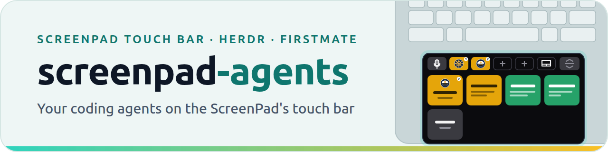
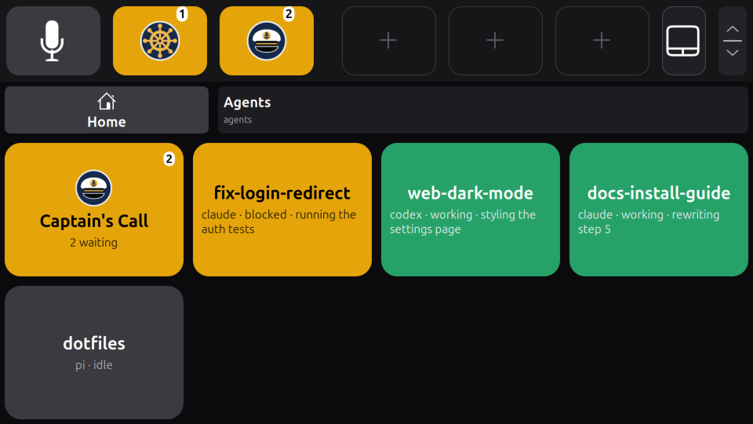
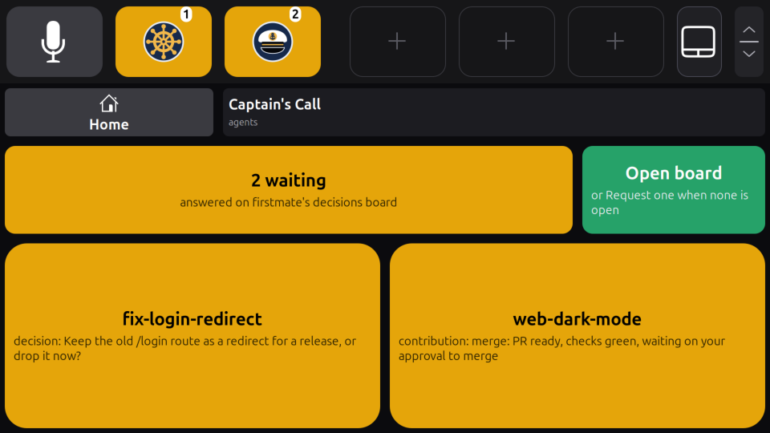
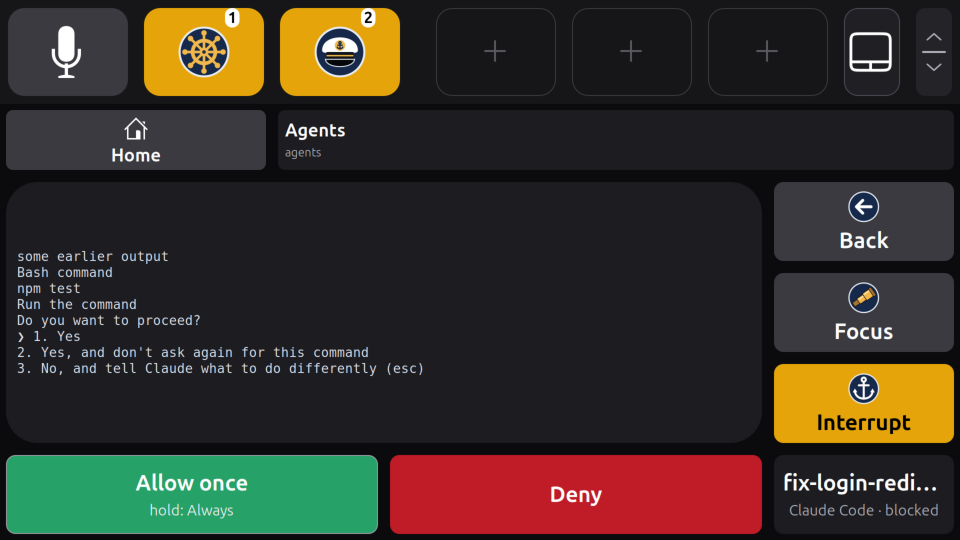

<p align="center">
  <picture>
    <source media="(prefers-color-scheme: dark)" srcset="docs/assets/banner-dark.png">
    
  </picture>
</p>

<h3 align="center">
  Puts your coding agents on the ASUS ScreenPad's touch bar:<br>
  who is working, who is blocked, and the calls waiting for you, a tap away.
</h3>

<p align="center">
  <a href="#what-it-needs"></a>
  <a href="#what-it-needs"></a>
  <a href="#features"></a>
  <a href="docs/agents.md#turning-it-on"></a>
  <a href="docs/development.md"></a>
  <a href="LICENSE"></a>
</p>

<p align="center">
  <a href="#features"><b>Features</b></a> ·
  <a href="#quick-start"><b>Quick start</b></a> ·
  <a href="#what-it-needs"><b>Requirements</b></a> ·
  <a href="#what-was-tested"><b>What was tested</b></a> ·
  <a href="#troubleshooting"><b>Troubleshooting</b></a> ·
  <a href="#documentation"><b>Documentation</b></a> ·
  <a href="#development"><b>Development</b></a> ·
  <a href="https://github.com/mmarsot/screenpad-linux"><b>screenpad-linux</b></a>
</p>

screenpad-agents puts your coding agents on the ASUS ScreenPad's touch bar, as an app of [screenpad-linux](https://github.com/mmarsot/screenpad-linux)'s touch bar. It shows every agent [Herdr](https://herdr.dev) reports, colored by its state, names the ones that are firstmate tasks, counts firstmate's Captain's Calls waiting for you, and lets you answer a Claude Code permission dialog from the panel. It is an ordinary client of the touch bar's [app API](https://github.com/mmarsot/screenpad-linux/blob/main/docs/app-api.md), with its own repository and installer.

<p align="center">
  
  <br>
  <sub>The Agents page with four agents, three of them firstmate tasks. Rendered by the touch bar's GNOME Shell extension in a headless GNOME Shell 50.1.</sub>
</p>

## Features

- **Every agent [Herdr](https://herdr.dev) reports**, one large widget each on the touch bar's apps page, colored by Herdr's own state: green while working, amber while blocked (waiting for you), grey when idle. Herdr is the authority on which agents run and in what state; the app only shows what it says.
- **firstmate tasks and decisions**, when you use firstmate: an agent whose pane is a task's endpoint is named after the task, and Captain's Call counts the decisions waiting for you and names them, on a page of its own with a button that opens firstmate's decisions board in the browser on the main screen, or asks firstmate for one and says when it is open; the panel answers none, except that a change ready for review gets Review, Approve and Request changes buttons (Review and Request changes need `review_command` in `[firstmate]`, a command like `/path/to/review-launcher {task}`). See [Captain's Call and the decisions board](docs/agents.md#captains-call-and-the-decisions-board).
- **An agent's card**, when you tap it: the agent's own screen, Focus and Interrupt, and for a Claude Code permission dialog Allow once, Always (a long press) and Deny, sent only if the dialog is still the one drawn. See [answering safely](docs/agents.md#answering-safely).
- **Items for the bar**, if you give them spots: the `agents` tile (how many agents, how many blocked) and Captain's Call's page, `page = "calls"` (the Captain's Call count; a tap opens the page). Each is drawn with the app's [nautical icons](docs/agents.md#its-icons): a ship's helm for the agents, the captain's cap for Captain's Call.
- **A Runs page**, optionally: every [no-mistakes](https://github.com/kunchenguid/no-mistakes) run per project and its status, read only, each joined to its agent and firstmate task, a warning when one agent has more than one active run, a run's card with its steps, findings, Focus and Open PR (its pull request in your browser), and a `runs` tile. See [Runs page](docs/runs.md).
- **Off until you turn it on.** It is installed off and runs only once you write its config. [The agent app](docs/agents.md) explains what it shows, its config and how it reads and acts.

<table>
  <tr>
    <td width="50%" valign="top"><br><sub>Captain's Call's page: the calls waiting, and a button that opens firstmate's decisions board, or asks for one.</sub></td>
    <td width="50%" valign="top"><br><sub>A blocked agent's card: its own screen, and the answers to its Claude Code permission dialog.</sub></td>
  </tr>
</table>

## Quick start

As your user, not root; nothing needs `sudo`. With [screenpad-linux](https://github.com/mmarsot/screenpad-linux)'s touch bar on and your agents in a Herdr session:

```sh
git clone https://github.com/mmarsot/screenpad-agents.git
cd screenpad-agents
./install.sh
```

Then write `~/.config/screenpad/agents.toml`, check it with `screenpad-agents show`, and start it with `systemctl --user enable --now screenpad-agents`: [Turning it on](docs/agents.md#turning-it-on) walks through each step and the bar's items. [Install](#install) says what goes where.

## What it needs

| | |
|---|---|
| Touch bar | [screenpad-linux](https://github.com/mmarsot/screenpad-linux)'s touch bar, installed and on (`screenpad-touchbar on`), speaking app protocol 2 |
| Agents | [Herdr](https://herdr.dev), with your agents in one of its sessions |
| Optional | firstmate, for task names, the Captain's Call count, the decisions board and interrupting a task through its control plane; no-mistakes, for the Runs page |
| Python | `/usr/bin/python3` 3.11 or newer with pip (on Ubuntu, `sudo apt install python3-pip`); the program uses only the standard library and the touch bar's client library, which `install.sh` installs next to it |

## What was tested

> [!NOTE]
> Not yet on the panel, and not yet against a real Claude Code dialog: everything below ran in isolated sessions with stand-ins.

Run, before it moved to this repository, against an isolated Herdr session with fake agents (a stand-in for Claude Code printing a permission dialog, which Herdr reported blocked) and firstmate's own reader and control plane on a throwaway firstmate home, through the touch bar daemon's socket: answers reached the stand-in only for the dialog drawn (a dialog changed between draw and tap got nothing), and Interrupt went through `fm-control.sh` for a task and Herdr's keys otherwise. Its page and card were drawn by the extension in a headless GNOME Shell 50.1.

After the move, the installed layout was checked with `./install.sh` and `./install.sh uninstall` in a throwaway home (the library fetched from its pinned commit), and the program run from this repository against an isolated Herdr session with a stand-in for Claude Code, firstmate's own reader on a throwaway firstmate home, and the tests' stand-in touch bar: a tap on Allow once reached the stand-in as `1`, and nothing was opened on the screen.

## Install

`./install.sh`, run from the checkout as in the [quick start](#quick-start) (as your user, not root; nothing needs `sudo`), installs under your home:

| Path | What it is |
|---|---|
| `~/.local/lib/screenpad-agents/` | the program: `agents.py`, its package `screenpad_agents/`, its icons in `icons/`, and in `vendor/` the touch bar's client library `screenpad_app`, which pip fetches from screenpad-linux at the commit `pyproject.toml` pins |
| `~/.local/bin/screenpad-agents` | the command, a link to `agents.py` (`~/.local/bin` should be on your `PATH`) |
| `~/.local/share/systemd/user/screenpad-agents.service` | its user unit, in `$XDG_DATA_HOME` when you set it; installed but not enabled, and it starts only once `~/.config/screenpad/agents.toml` exists |

Then write the config and turn it on: [Turning it on](docs/agents.md#turning-it-on).

If you installed screenpad-linux with its own copy of this app (`/usr/local/bin/screenpad-agents` and `/usr/lib/systemd/user/screenpad-agents.service`, still installed until screenpad-linux drops it), this install shadows it: the units share a name and the one under your home takes precedence. Which command runs depends on your `PATH`; `command -v screenpad-agents` should print `~/.local/bin/screenpad-agents`.

To update, pull and run `./install.sh` again: it replaces the program whole and keeps your config. If the app is running, `systemctl --user restart screenpad-agents` then runs the new version.

## Uninstall

```sh
./install.sh uninstall
```

It stops and disables the unit if you enabled it, and removes the three paths above. Your config, `~/.config/screenpad/agents.toml`, is kept; delete it by hand if you no longer want it. The touch bar itself is screenpad-linux's and is left as it is.

If screenpad-linux installed its own copy of the app, uninstalling this one brings that copy back: its unit `screenpad-agents.service` and its command `/usr/local/bin/screenpad-agents` are then the ones systemd and your `PATH` find, but the unit is left disabled; run `systemctl --user enable --now screenpad-agents` to run it again.

## Troubleshooting

| Problem | Where to look |
|---|---|
| `screenpad-agents: command not found` | `~/.local/bin` is not on your `PATH`; run `~/.local/bin/screenpad-agents`, or add it |
| `install.sh: pip is missing` | install pip for `/usr/bin/python3` (`sudo apt install python3-pip`), then run `./install.sh` again |
| `the client library screenpad_app is not in ...` | the install is incomplete; run `./install.sh` again |
| The app shows nothing, or Herdr unavailable | `screenpad-agents show`, then the [agent app troubleshooting](docs/agents.md#troubleshooting) table |
| The touch bar refuses the app's protocol version | the log (`journalctl --user -u screenpad-agents`) says which side to update: screenpad-linux, or this app |

## Documentation

| Document | Contents |
|---|---|
| [Agent app](docs/agents.md) | what it shows, Captain's Call and the decisions board, an agent's card and answering safely, the keymap, its config, turning it on, how it reads and acts |
| [Runs page](docs/runs.md) | the no-mistakes runs per project: turning it on, which projects, the joins to agents and tasks, the warning, a run's card, opening its pull request, how it reads |
| [Development](docs/development.md) | code layout, the checks and the test suite |
| [Touch bar app API](https://github.com/mmarsot/screenpad-linux/blob/main/docs/app-api.md) | in screenpad-linux: the socket protocol this app speaks, and the client library |
| [screenpad-linux](https://github.com/mmarsot/screenpad-linux) | the ScreenPad's display and touch bar this app runs on, in its own repository |

## Development

```sh
make vendor                            # fetch the client library into vendor/
python3 -m unittest discover -s tests  # the tests
make check                             # everything CI runs: format, lint, typecheck, tests
```

The tests need no touch bar, no Herdr, no firstmate and no no-mistakes: they use stand-ins for all four. The format, lint and type checks run through uv, as [Development](docs/development.md) explains. Contributors and coding agents start from [AGENTS.md](AGENTS.md).

## License

Released under the [MIT License](LICENSE).
