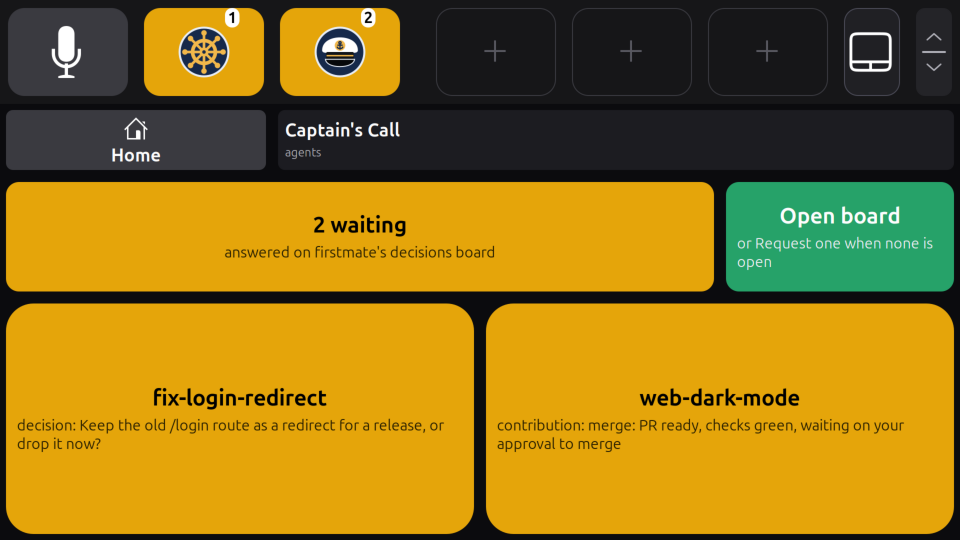

# The agent app

`screenpad-agents` puts your coding agents on the touch bar. It is a separate program, an ordinary [app of the touch bar](https://github.com/mmarsot/screenpad-linux/blob/main/docs/app-api.md), with nothing special in the touch bar's daemon ([screenpad-linux](https://github.com/mmarsot/screenpad-linux)). It shows:

- **every agent [Herdr](https://herdr.dev) reports**, one large widget each on the [apps page](https://github.com/mmarsot/screenpad-linux/blob/main/docs/touchbar.md#the-two-pages), colored by Herdr's own state: green while working, amber while blocked (waiting for you), grey when idle or unknown. Herdr is the authority on which agents run and in what state; the app only shows what it says.
- **which firstmate task each agent is**, when you use firstmate: an agent whose pane is a task's recorded endpoint is named after the task, with what the task is doing. Agents outside firstmate still show, named after their directory.
- **how many Captain's Calls are waiting** in firstmate, decisions and contributions that need you, and **which ones**, on [Captain's Call's page](#captains-call-and-the-decisions-board), with a button that opens firstmate's decisions board in your browser on the main screen, where you answer them, or asks firstmate to build it.
- **an agent's card**, when you tap it: the agent's own screen, Focus and Interrupt, and when it waits on a Claude Code permission dialog, the answers: Allow once, Always and Deny.
- two **tiles for the bar**, if you give them spots: `agents` (a ship's helm, with how many agents are blocked) and `calls` (the captain's cap, with the Captain's Call count); and a third page, **Captain's Call** (`calls`), which a `page` item on the bar opens.
- optionally, with `[runs]` in its config, a second page, **[Runs](runs.md)**: your projects' no-mistakes runs and their status, each joined to its agent and task, with a warning when one agent has more than one active run, and a `runs` tile.


*The Agents page with four agents, three of them firstmate tasks, and the `agents` tile and Captain's Call's page item (`page = "calls"`) in the bar (208 px high). Rendered by the extension in a headless GNOME Shell 50.1, from the app's own page and tiles fed to the daemon's own code, with a stand-in Herdr and firstmate reader.*

## Its icons

The app draws itself with its own icons, SVGs in `icons/` that `install.sh` installs with the program (`~/.local/lib/screenpad-agents/icons/`), given to the touch bar by absolute path. Each is drawn on a navy disc with a light rim, so it reads on every tone (grey, green, amber, red) and on the dark panel:

| Icon | Where |
|---|---|
| a ship's helm (`helm.svg`) | the Agents page in the home page's list, and the `agents` tile |
| the captain's cap (`captain.svg`) | Captain's Call: the widget, its page and the `calls` tile |
| a lighthouse (`lighthouse.svg`) | the [Runs](runs.md) page and the `runs` tile |
| a back arrow (`back.svg`), a spyglass (`spyglass.svg`), an anchor (`anchor.svg`) | Back, Focus and Interrupt on [an agent's card](#an-agents-card) (Back and Focus on a run's card, Back on Captain's Call's view) |

On the bar a tile with an icon shows only the icon, its badge (blocked agents, Captain's Calls waiting, runs needing you) and its tone; the home page's list shows the icon with the label and text. A tile whose source cannot be read (Herdr unavailable, firstmate unreadable or stale, no-mistakes unavailable) shows its words instead, so the bar says what is wrong. The Captain's Call widget has its cap while the grid has two rows; with more, its cell is too short for icon, label and text, and it keeps its label, text and badge.

Tap an agent's widget to open [its card](#an-agents-card). Tap the `agents` tile to focus the first blocked agent's pane in Herdr. Tap the Captain's Call widget to see [the calls waiting](#captains-call-and-the-decisions-board) in place of the grid; the `calls` page item on the bar opens the same view as a page of its own, and a `calls` tile opens firstmate's decisions board on the main screen straight away. Each reads firstmate again at once.

The panel answers no Captain's Call: it takes you to the board, where you answer them.

## Turning it on

[`install.sh`](../README.md#install) installs the app but leaves it off: **it refuses to run until you write its config**, so installing it changes nothing.

1. Write `~/.config/screenpad/agents.toml`:

   ```toml
   [herdr]
   session = "default"          # the Herdr session your agents run in

   [firstmate]                  # leave this table out without firstmate
   home = "/home/you/firstmate" # your firstmate home (FM_HOME)
   code = "/home/you/firstmate" # the firstmate checkout with bin/fm-bearings-snapshot.sh and bin/fm-control.sh
   ```

   The unit runs with your session's `PATH`. If `lavish-axi` or the `node` it needs is not on it (a node from nvm usually is not), name them: `lavish = ["/home/you/.nvm/versions/node/v24.18.0/bin/node", "/home/you/.local/bin/lavish-axi"]` in `[firstmate]`.

2. Check what it would show:

   ```sh
   screenpad-agents show
   ```

   (`~/.local/bin`, where `install.sh` puts the command, must be on your `PATH`; otherwise run `~/.local/bin/screenpad-agents show`.) It prints each agent with its pane, kind, state and task, then the Captain's Call count, and exits 1 when Herdr does not answer.

3. Start it, and keep it on at every login:

   ```sh
   systemctl --user enable --now screenpad-agents
   ```

4. Optionally, give its tiles spots in the bar, in `~/.config/screenpad/touchbar.toml` (at most three buttons in all, see [configuration](https://github.com/mmarsot/screenpad-linux/blob/main/docs/configuration.md#settings)):

   ```toml
   [[button]]
   icon = "utilities-terminal-symbolic"
   label = "Agents"
   tile = "agents"

   [[button]]
   label = "Calls"
   page = "calls"
   ```

   The second item is Captain's Call's page, not a tile: a tap on it turns to the apps page on [Captain's Call](#captains-call-and-the-decisions-board), and the bar draws it with the page's cap, its count as a badge and its tone, as it would the `calls` tile. (A tile cannot turn the apps page: the touch bar's protocol has no message for that.) If your bar has `tile = "calls"` from an earlier version, change that line to `page = "calls"`; a `calls` tile you keep opens the decisions board straight away. Without spots the app still gives the apps page its **Agents** and **Captain's Call** pages; it logs that the `agents` tile has no spot (not the `calls` tile, which the page item replaces).

To turn it off: `systemctl --user disable --now screenpad-agents`. Removing the config also keeps the unit from starting (`ConditionPathExists`).

## The config

`~/.config/screenpad/agents.toml` (or `$XDG_CONFIG_HOME/screenpad/agents.toml`; `--config FILE` for another one). It is strict: an unknown table or key, or a bad value, stops the app with a message naming it (exit status 2). The unit does not restart after such an error, so once the config is fixed, start it again: `systemctl --user restart screenpad-agents`.

| Setting | Meaning |
|---|---|
| `[herdr] session` | required: the Herdr session to read. Every Herdr call names it (`--session`), never the session the environment would pick |
| `[herdr] command` | the Herdr program, `"herdr"` by default; or a list of words, for a wrapper and its arguments |
| `[herdr] poll` | seconds between two reads of Herdr's agents, 1 to 60, default 2 |
| `[firstmate] home` | your firstmate home, an absolute path. There is no default: without `[firstmate]` nothing of firstmate is read, and the page has no Captain's Call |
| `[firstmate] code` | the firstmate checkout, an absolute path; it must have an executable `bin/fm-bearings-snapshot.sh` and `bin/fm-control.sh`. Captain's Call also uses its `bin/fm-bearings-board.sh` and `bin/fm-inbox.sh`, checked when you tap |
| `[firstmate] poll` | seconds between two reads of firstmate, 60 to 3600, default 60 |
| `[firstmate] lavish` | the program that lists Lavish's sessions, to find the decisions board open: `"lavish-axi"` by default; or a list of words, such as a `node` and the script |
| `[runs]` | optional: the [Runs page](runs.md#turning-it-on) and its settings (`repos`, `firstmate`, `command`, `poll`, `idle`). Without it no-mistakes is never run |

## The Agents page

The page is a grid four widgets wide and two to four rows high: Captain's Call first, then one widget per agent in Herdr's order, so a widget stays where it is while its agent runs. When the agents do not all fit in its 16 cells, the last one says how many more there are. The home page's list shows the page with its helm, the agent count and the number blocked.

A widget's label is the agent's firstmate task (or its directory), and its text the agent's kind, its state and what the task is doing. The touch bar's own rules keep a tap safe: a widget that changed in the last 0.3 s takes no touch, and one that changes under a finger cancels that touch (see [What a touch does](https://github.com/mmarsot/screenpad-linux/blob/main/docs/app-api.md#pages-on-the-apps-page)).

## Captain's Call and the decisions board

firstmate's Captain's Calls are free text, with no list of answers a button could give, so the panel does not answer them: it shows which calls wait and takes you to where you answer them, **firstmate's decisions board**, the Lavish board `/bearings lavish` builds.

### Captain's Call's page



*Captain's Call's page with two calls waiting, under a bar 208 px high. Rendered like the page above.*

The app gives the apps page a page of its own, **Captain's Call** (`calls`): the page item `page = "calls"` on the bar opens it ([above](#turning-it-on)), and the home page's list shows it with its cap, the count and its tone. A tap on the Agents page's Captain's Call widget shows the same view in place of the grid, with **Back**. The app lays it out itself, a grid of 4 cells by 3, in large boxes:

- the **count** across the top (`2 waiting`, `none waiting`, or `firstmate unreadable` and why), over three cells, or two beside Back;
- the **board's button** in the last cell of the top row, saying what a tap does now (below);
- the **calls waiting** under them, each over two cells (one or two calls over both rows), as firstmate's reader lists them: a decision by its task and summary (`decisions_open`), a contribution by its task, its kind and the reason it needs you (`contributions.captain`). Four fit; with more, the last box says how many more are on the board (`+3 more`, or `+3+ more` when the reader left some out itself).

Each text is fitted to its box (`screenpad_agents/callpage.py`, from the extension's own sizes under a bar 208 px high: a one-cell box holds about 16 characters of label and 72 of text, a two-cell box 36 and 150), so the box cuts nothing; a longer one is cut at a word with an ellipsis. The whole of a call is on the board, and the journal keeps a whole error. A lower bar gives taller boxes.

### The board's button

| It says | When | A tap |
|---|---|---|
| **Open board** (or Request one when none is open) | the app has not looked yet | looks for the board, and opens it |
| **Open board** (the board is ready) | the board is open in Lavish | opens it |
| **Request board** | no board is open | asks firstmate to build it |
| **Opening board…** (or `firstmate: <its reply>`) | the app waits for the board it asked for | looks for it again, and opens it if it is open |
| **Open board** (shown on the main screen) | it opened the board | opens it again |
| **Retry** (no board in 3 minutes, or `firstmate: <its reply>`) | no board came | asks firstmate again |
| **Retry** (request failed: why) | the note to firstmate failed | asks firstmate again |
| **Open board** (not opened: why), in red | finding or opening the board failed | tries again |

The button's id names what it shows, so a tap on a button the page no longer shows does nothing; a tap acts when you lift on it, with the touch bar's usual rules (no touch in the 0.3 s after the button appears or changes, sliding away cancels). Opening the view from the Agents page looks for the board at once, so its button says Open board or Request board.

### Opening the board

1. The app asks firstmate which file the board is: `FM_HOME=<home> <code>/bin/fm-bearings-board.sh path`.
2. It asks Lavish whether that board is open: `lavish-axi`'s session listing (the program, with no argument), the row for that file (both paths compared resolved, so a symlinked home matches) with status `open` and its session URL.
3. If it is, it opens that URL with the desktop's URL handler (`gio open <url>`), the way Lavish itself opens firstmate's boards: your browser shows the board's session in its window. The app moves no window: the board shows where your browser's window is, which is the main screen unless you moved that window to the ScreenPad (where the apps page would cover it). Only a URL on this machine (`http://127.0.0.1`, `localhost` or `[::1]`) is opened.

   The handler runs in a transient systemd scope of its own, `systemd-run --user --scope --collect --quiet -- gio open <url>`, never in the app's unit: a browser it starts (when none is running yet) is then a `run-*.scope` of your session, not a process of `screenpad-agents.service`, and does not count against the unit's `MemoryMax=64M`. Started inside the unit, it did, and the kernel killed the browser and the app together. When there is no `systemd-run`, or it cannot make the scope, nothing is opened and the button says so (`not opened: systemd-run not found`).
4. If no board is open, it opens nothing and builds nothing (firstmate composes the board): the button says **Request board**.

A tap on a `calls` tile does all of this straight away, and the button on the page says what came of it. A second tap while the board is being looked for adds nothing.

### Asking firstmate for the board

**Request board** asks firstmate to build it, with one note in firstmate's inbox:

```sh
FM_HOME=<home> <code>/bin/fm-inbox.sh note --json --request-id <id> -- "Please open the decisions board: /bearings lavish. Asked from Captain's Call on the ScreenPad, where no decisions board is open."
```

which wakes firstmate once. The id (`screenpad-board-<time>-<random>`) is the app's own, one per request. At once the button says **Opening board…** (building it takes firstmate about a minute), and so does the Captain's Call widget (`2 waiting · opening board`), for as long as the app waits. Meanwhile, every 10 seconds, the app checks whether the board is open (steps 1 and 2) and what firstmate did with its note, through `fm-inbox.sh`'s read-only view of its notes, `FM_HOME=<home> <code>/bin/fm-inbox.sh receipts` (it writes nothing and wakes no one): whether firstmate has handled it, and the reply it recorded against it (`fm-inbox.sh reply`), if any, which the button then shows. The wait ends

- when the board is open: the button says **Open board** and opens it (Lavish may have opened it in your browser already);
- after 3 minutes with no board, or 30 seconds after firstmate replied with none open: the button says **Retry**, with firstmate's reply when it gave one;
- when a tap finds the board open and opens it;
- when the note fails: the button says **Retry** and why.

The Captain's Call count is read again right after the request and when the board is open, so the count, the calls listed and the board agree as soon as they can. The checks run only while the app waits; otherwise it reads firstmate once a minute as always. Nothing of the wait is kept on disk: an app that restarts has none, and its button offers to open the board again.

While the app waits, tapping queues no second note. A request keeps its id for 5 minutes (unless the board was seen open), so **Retry** meanwhile makes `fm-inbox.sh` replay a note it may have saved before failing, or one firstmate has not handled yet, rather than queue a second; after that, firstmate may have handled the note already (a replay would wake nothing), so a retry is a new request. When `fm-inbox.sh` answers (in its `fm-inbox-note.v1` JSON) that firstmate has already handled the replayed note, acknowledged or moved to `handled/`, the app asks once more at once under a new id. Nothing here sends anything to an agent, and the only thing it writes into firstmate is that note, through firstmate's own `fm-inbox.sh`; the board answers through firstmate's own intake.

## An agent's card


*The card of a blocked agent, opened from the Agents page. Rendered like the page above.*

Tapping an agent opens its card in place of the grid, until you tap **Back**, an answer is sent, or the agent leaves Herdr's list. It shows the last lines of the agent's own screen (Herdr's `pane read`, without the dialog's frame or blank lines, at most 16 lines of 120 characters; a longer dialog shows its end, and **Focus** shows it whole), read again every `poll` seconds while the card is open.

- **Focus** focuses the agent's pane in Herdr.
- **Interrupt** interrupts the agent. For a firstmate task it runs firstmate's control plane, `FM_HOME=<home> <code>/bin/fm-control.sh <task> interrupt`, which knows the task's harness and checks the result; for another agent it sends its harness's interrupt key through Herdr (Escape for Claude Code), after checking that the same kind of agent is still in the pane. For an agent whose harness the app does not know, or while firstmate has not been read yet, Interrupt is dimmed and says why in place of its anchor. The card says what firstmate or Herdr answered.
- **Answers**, while Herdr reports the agent blocked on a permission dialog its harness's keymap knows (below): **Allow once** is a tap, **Always** a long press (0.8 s) on the same button, shown as "hold: Always" only when the dialog offers it, and **Deny** a tap.

### Answering safely

The touch bar never takes a touch that starts within 0.3 s of a widget appearing or changing, and cancels a finger on a widget that changes. The card builds on that, and the app checks again right before it types:

- The answer buttons' ids carry a digest of the screen drawn and the agent's `state_change_seq`, so a screen that changed is new buttons: the touch bar arms them again for 0.3 s, a finger already on the old ones chooses nothing, and a tap names the screen it was made on. A tap on buttons the card no longer shows does nothing.
- **Keys are sent only if, at the moment of sending, all three still hold:** Herdr reports the agent still blocked (and the same kind of agent); its `state_change_seq` is the one recorded when the card was drawn; and a fresh `pane read`, taken immediately before `send-keys`, gives the very lines drawn (the same digest).
- On any mismatch nothing is sent: the card is drawn again with the new screen and says "nothing sent" and why, and a fresh tap on the new buttons is needed, after the 0.3 s again. Herdr's pane `revision` is not used: it does not change when a dialog does, and `state_change_seq` changes only with the state, so a dialog swapped for another (`npm test` turned `rm -rf build`, still blocked) is caught only by the text.
- While an answer is on its way its buttons are hidden, so a second tap cannot follow it.

A screen that changes on every read (a clock or a spinner in the dialog's lines) gives new buttons every `poll` seconds; answer such an agent in its pane.

### The keymap

The answers come from a per-harness keymap, keyed by the kind of agent Herdr reports. It starts with Claude Code (`claude`):

| Answer | Keys | Offered when the drawn lines show |
|---|---|---|
| Allow once | `1` | a question line "Do you want to …?", and right under it the option `1. Yes` and nothing more |
| Always | `2` | the next option, `2. Yes, …` ("and don't ask again …", "allow all edits during this session") |
| Deny | Escape | an option `No` under the question |
| Interrupt | Escape | (always, for an agent of that kind) |

The dialog is the last question line on the screen with its options right under it, so a question in earlier text over another dialog's numbered choices (Claude Code's plan approval, "1. Yes, and auto-accept edits") is never answered.

A dialog that matches none of this, or one that must never be answered with a key (Claude Code's folder-trust, external-imports and bypass-permissions dialogs), and every agent of another harness, gets a read-only card: its screen, Focus and Interrupt, and "no dialog this card knows" (or "answer it in its pane" for a harness with no keymap, or when its screen could not be read). A new harness is one entry in `screenpad_agents/keymap.py`.

## How it reads and acts

- **Herdr:** `herdr agent list --session <session>` every `poll` seconds, and while a card is open `herdr agent get <pane>` and `herdr pane read <pane> --source visible --format text`; `herdr agent focus <pane>` on Focus, and `herdr agent send-keys <pane> <keys>` for an answer that passed the checks above or an interrupt; every one with `--session <session>`. They run off the app's loop, so a slow Herdr never delays a touch.
- **firstmate:** its own read-only reader, never its files:

  ```sh
  FM_HOME=<home> <code>/bin/fm-bearings-snapshot.sh --json --fields endpoints
  ```

  It takes about 3 s, and runs at most once a minute plus when you open Captain's Call's view, tap the `calls` tile or the board's button, and after a request. Looking for the board runs `FM_HOME=<home> <code>/bin/fm-bearings-board.sh path` and `lavish-axi`, opening it also `gio open` with the board's URL in a scope of its own (`systemd-run --user --scope`, outside the app's unit), and **Request board** runs `FM_HOME=<home> <code>/bin/fm-inbox.sh note --json --request-id <id> -- <text>`, then, every 10 seconds for at most 3 minutes, `fm-bearings-board.sh path`, `lavish-axi` and `FM_HOME=<home> <code>/bin/fm-inbox.sh receipts` (read-only), [above](#captains-call-and-the-decisions-board), in the thread of firstmate's control. Interrupting a task's agent runs `FM_HOME=<home> <code>/bin/fm-control.sh <task> interrupt` in a thread of its own; it and that note are the only firstmate commands the app runs that act on anything (`fm-bearings-board.sh` runs only as `path`, `fm-inbox.sh` otherwise only as `receipts`; the app never builds or arms a board, and never replies to or acknowledges a note). The count is the number of open decisions plus the captain's contributions (`decisions_open` and `contributions.captain` in its `fm-bearings.v1` output), shown with a `+` when the reader left some out; Captain's Call's page names each one the reader lists (a decision's `id` and `summary`, a contribution's `task`, `kind` and `reason`). Each task's endpoint, `<session>:<pane id>` for Herdr, joins the task to the agent Herdr reports in that pane. The app passes firstmate's commands only `FM_HOME`, none of the other `FM_*` variables of its own environment, and `lavish-axi`, `systemd-run` and `gio` no `FM_*` variable at all.
- **no-mistakes**, with `[runs]`: only its read-only `axi`, `axi status` and `axi rounds` commands, [on the Runs page](runs.md#how-it-reads); with `[runs] firstmate`, firstmate's reader is asked for `--fields endpoints,paths`, for its tasks' worktrees.
- **The touch bar:** the socket in `$XDG_RUNTIME_DIR/screenpad/touchbar.sock`, as app `agents` with tiles `agents` and `calls` (only `agents` without firstmate), and `runs` with `[runs]`, and pages `agents` and `calls` (only `agents` without firstmate), and `runs` with `[runs]`. It talks to it through the [client library](https://github.com/mmarsot/screenpad-linux/blob/main/docs/app-api.md#the-python-client-library) `screenpad_app`, speaking app protocol 2: it sends a page or tile only when it changed, and connects again every 5 s while the daemon is not running or refuses its protocol version (a touch bar too old for it, logged once with what to update).

## Troubleshooting

| Problem | Where to look |
|---|---|
| `agents.toml does not exist` | Write the config (above); the app runs only once you do |
| The page says **Herdr unavailable** | `screenpad-agents show` prints Herdr's error. Is the Herdr server running, and is `[herdr] session` the session your agents are in (`herdr session list`)? |
| **No agents** | Herdr reports none in that session; `herdr agent list --session <session>` |
| An agent shows without its task | firstmate has no Herdr endpoint for that pane in that session; `screenpad-agents show` lists the join |
| The bar's Captain's Call opens the board, not the page | that spot is the `calls` tile (`tile = "calls"`, from an earlier version): change that line to `page = "calls"` in `touchbar.toml` ([above](#turning-it-on)). A tile cannot turn the apps page |
| The button says **Request board** | firstmate has no Lavish board open: tap it (or ask firstmate for `/bearings lavish` yourself); Lavish opens the board once firstmate has built it, and the button then opens it too |
| It says **Opening board…** for a while | firstmate has the note but has not built the board yet: it builds it when it next drains its inbox (`FM_HOME=<home> <code>/bin/fm-inbox.sh status` shows the note). Tapping meanwhile queues nothing more; after 3 minutes the button says **Retry** |
| It says **Retry**: no board in 3 minutes, or firstmate's reply | no board was open 3 minutes after the request (or 30 seconds after firstmate replied). **Retry** asks again: under the same request id for 5 minutes, so a note firstmate has not handled yet is not queued twice; once firstmate handled it, one new note. A check that failed meanwhile is in the journal (`checking for the decisions board: …`) |
| It says **Retry**: request failed | `fm-inbox.sh note` failed, and the button says why: a firstmate checkout without `bin/fm-inbox.sh`, or the note's own error (it may have saved the note but not woken firstmate). **Retry** tries again under the same request id for 5 minutes, so `fm-inbox.sh` replays a saved note rather than queueing a second (or, if firstmate already handled it, the app queues one new note); later it asks anew |
| It says **not opened** | the button says which command failed (a long message is cut to the button; the journal has it whole): `lavish-axi` not found by the unit (set `[firstmate] lavish`, above), `systemd-run` not found by the unit (it is part of systemd: give the unit a `PATH` that has it; the board is never opened without it, as a browser started in the unit got it and the app OOM-killed), the desktop's URL handler (`systemd-run` or `gio open`, whose own message is in the journal, `journalctl --user -u screenpad-agents`, such as `Failed to start transient scope unit`; the button gives its exit code), or a firstmate checkout without `bin/fm-bearings-board.sh` |
| Captain's Call counts calls the board does not show | the count and the calls listed are firstmate's reader's, which may still hold a row the board has dropped (a contribution in firstmate's cache, for one): the page names that row, so you can tell firstmate which one is stale |
| Captain's Call says **firstmate unreadable** or **(stale)** | the reader failed; the app logs why once (`journalctl --user -u screenpad-agents`). Meanwhile the `calls` tile shows these words in place of its cap |
| A blocked agent's card has no answer buttons | Its harness has no keymap, or its screen is not a permission dialog the keymap knows (the card says "answer it in its pane" for a harness with no keymap or an unreadable screen, "no dialog this card knows" for a screen its keymap does not recognise); answer it there, through **Focus** |
| An answer says **nothing sent** | The dialog or the agent's state changed between the card being drawn and your tap; read the new card and tap again |
| **Interrupt** is dimmed | The agent's harness has no known interrupt key and it is no firstmate task, or firstmate has not been read yet |
| **Interrupt** says failed | firstmate's control plane refused (`fm-control.sh` says why) or Herdr did; the app logs it (`journalctl --user -u screenpad-agents`) |
| The tiles stay dimmed | the app is not running, or another app provides the tiles; `systemctl --user status screenpad-agents` |
